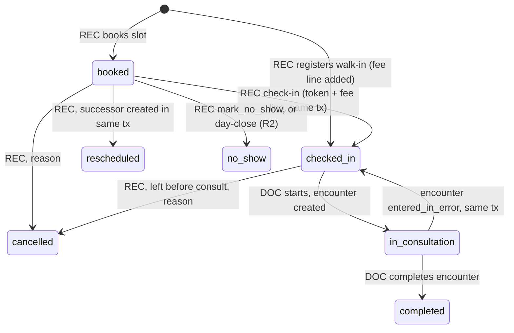
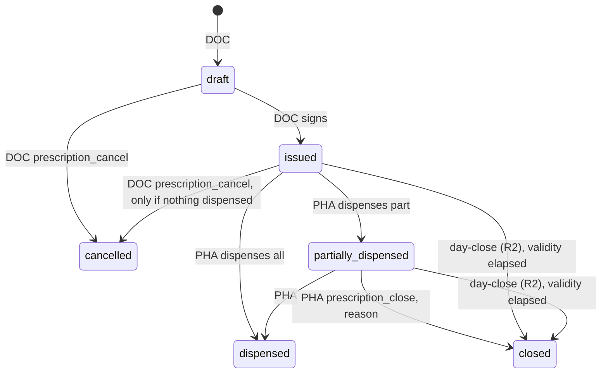
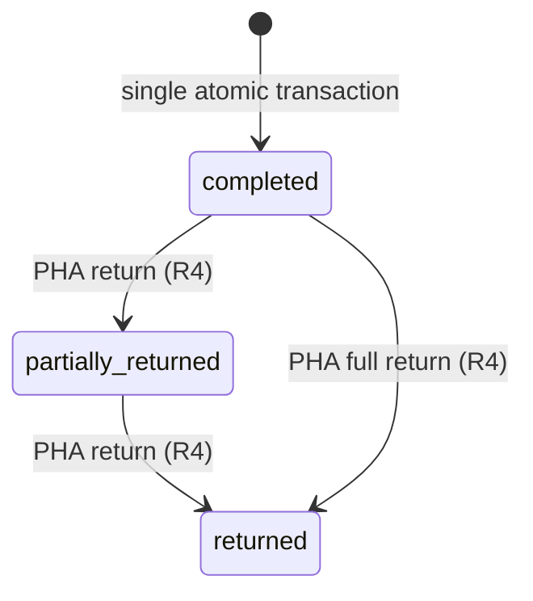
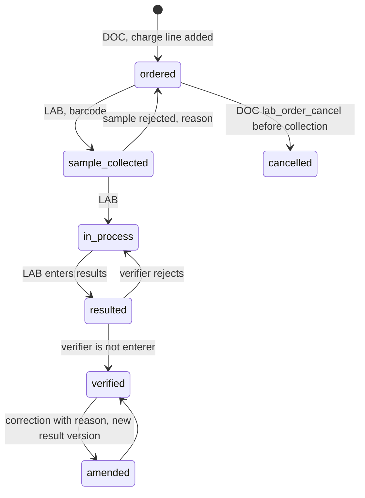
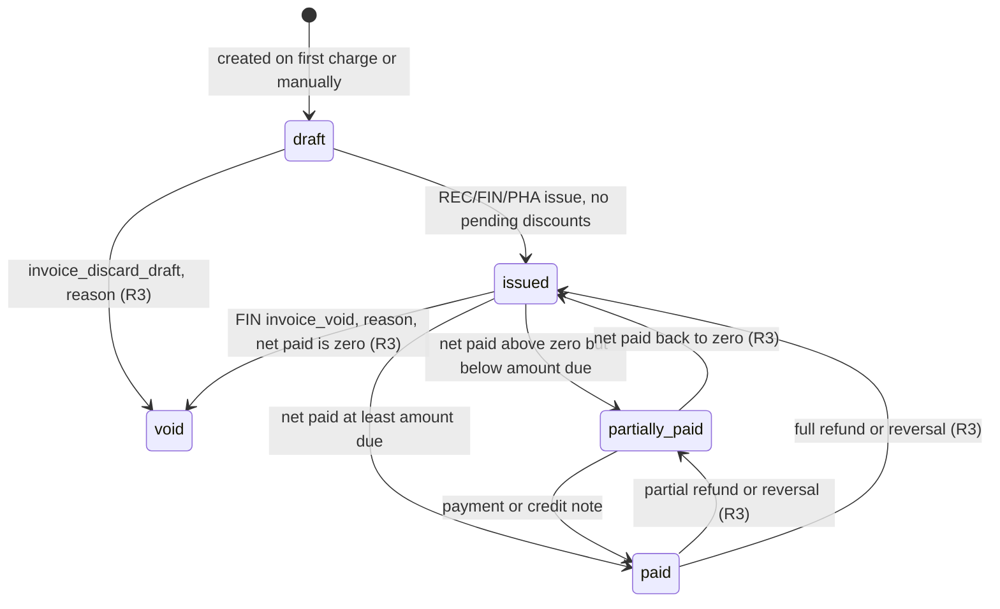
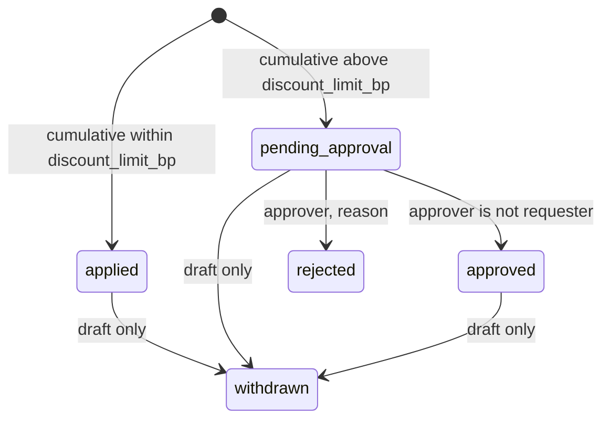
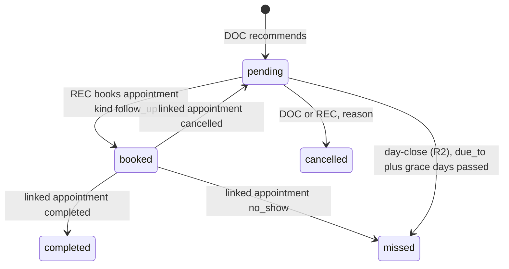
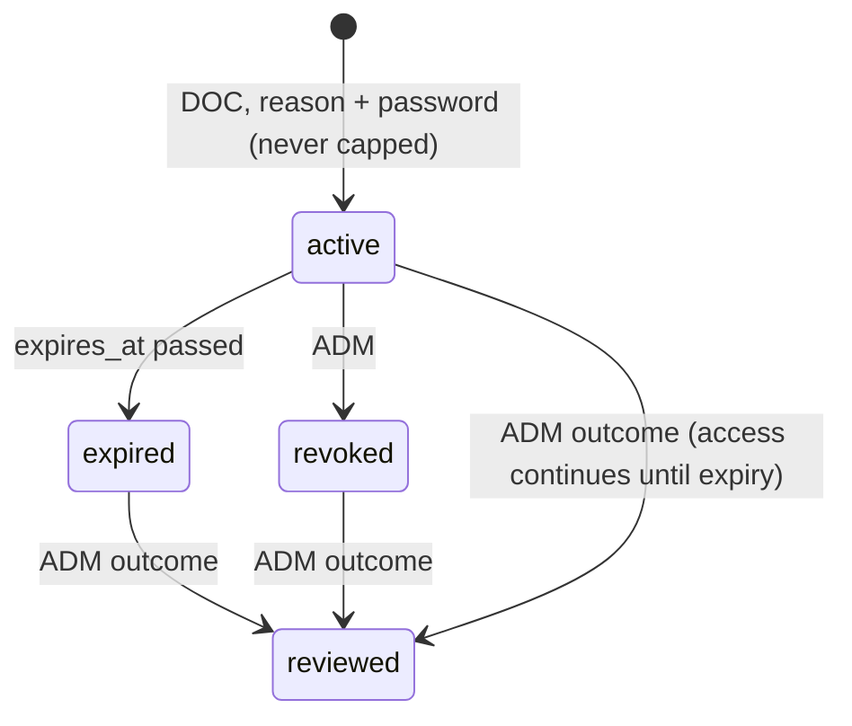
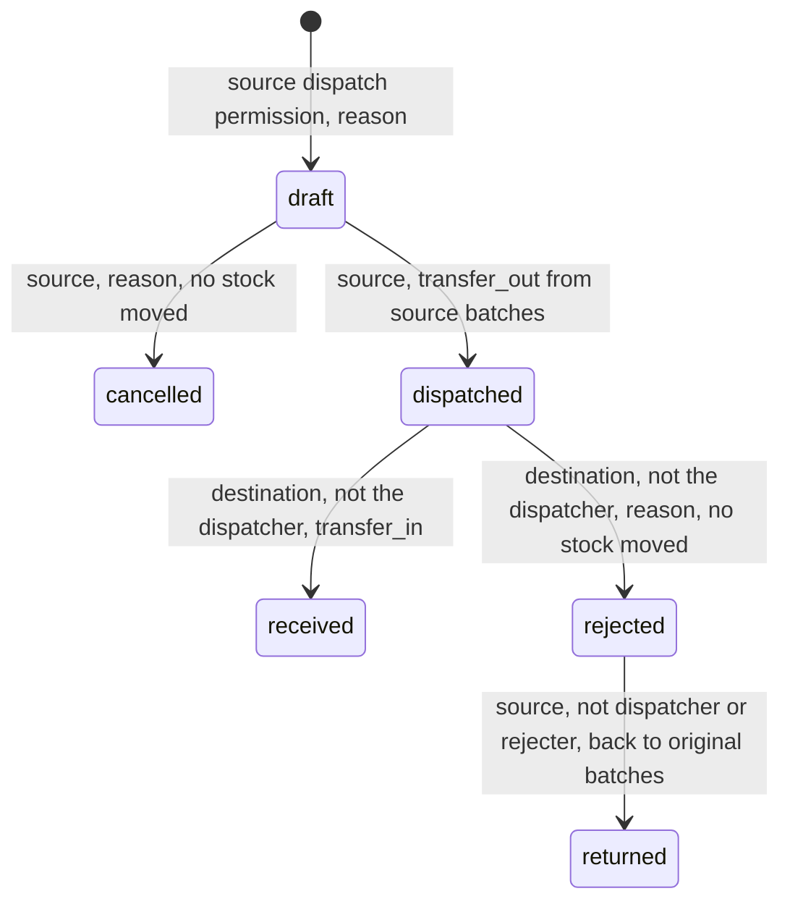

# HospitalOS Mobile: workflows

Status: **final draft for owner review**, 2026-11-05 (all owner decisions of 2026-11-05 applied,
including D1 to D6 and the Release 1 corrections MD-20 to MD-22).

The rules here come from the reference's `docs/state-machines.md`, `docs/requirements.md` and
`docs/erd.md`. The mobile app adds screens, not rules, with one deliberate change approved by the
owner: **no automatic credit notes** (section 4). Every transition is performed by the API,
which checks the permission and the record-level rule; any transition not listed is refused with
409. Criteria IDs (BK-2, DP-7, …) are the reference's.

## 1. How work moves between departments

```text
Reception                Nurse / Doctor                    Pharmacy · Lab · Billing
─────────                ──────────────                    ────────────────────────
register (MRN) ───────► patient appears in My appointments
book / walk-in
check-in (token) ─────► nurse: vitals, allergies
  └ draft invoice       doctor: consultation
    + consultation fee    notes, diagnoses, allergies
                          prescription ────────────────► pharmacy queue → FEFO dispense
                          lab order ───────────────────► lab worklist → collect → result → verify
                          follow-up recommended                                (result in chart)
                          complete (addenda only after)  invoice gets lab + medicine lines
                                                         → issue → payment(s) → receipt
reception books the follow-up ◄──────────────────────── follow-up pending / due / overdue
```

Any department with a lookup permission types the patient number (`MRN000123`, `mrn 123` or `123`)
to see that patient's records for its own work.

**Every queue is read from the API.** Doctor lists, schedules, medicines, prices, patients and
work items are database records served by the backend; the app holds no copy of them as a source of
truth (scope MD-12).

**On the phone, the "flow" is a queue.** Each role's Work Queue tab is the list the previous step
feeds. In R1 queues refresh when the screen is focused and every 15 seconds while it is open; live
updates arrive in R7 over Server-Sent Events, as in the reference.

## 2. The outpatient patient journey

This is the Release 1 acceptance scenario. Each step names who does it, on which screen, and the
criteria its tests prove.

| # | Step | Role · screen | Criteria |
|---|---|---|---|
| 1 | Find the patient or register them; duplicate warning on same phone and date of birth | REC · Search → Register | PR-1 to PR-4 |
| 2 | Choose doctor and a free slot; book | REC · Doctor availability → Book | SC-1, BK-1, BK-2, BK-3 |
| 3 | Patient arrives; check in (token; consultation fee on the draft invoice) | REC · Queue → Check in | QU-1, QU-2, CF-1, CF-2 |
| 4 | Nurse assigned to the session records vitals and allergies | NUR · My patients today → Vitals | QU-4, AX-7, AX-13 |
| 5 | Doctor opens the chart and starts the consultation | DOC · My queue → Chart → Start | AX-1, AX-8 |
| 6 | Notes, diagnoses, allergies; prescription (allergy acknowledgement; substitution allowed or not); lab order; follow-up | DOC · Encounter | CN-1, CN-2, RX-4, FU-1 |
| 7 | Doctor checks medicine availability | DOC · Search → Medicines | RX-1 to RX-3 |
| 8 | Doctor completes the encounter (appointment completed in the same transaction) | DOC · Encounter → Complete | CN-1 |
| 9 | Lab collects the sample (barcode), enters results, a second technician verifies; result reaches the chart | LAB · Worklist | LB-1 to LB-5 |
| 10 | Pharmacist reviews allergies and dispenses first-expiry-first-out, with substitution if allowed | PHA · Prescription queue → Dispense | DP-1 to DP-4, DP-8, DP-10, EX-*, SB-* |
| 11 | Stock movements recorded per batch; medicine lines added to the visit's draft invoice | (server) | DP-1, DP-6, DP-7 |
| 12 | Invoice issued; payment recorded (part payments allowed); receipt viewed in the app | REC or FIN · Invoice → Pay → Receipt | CF-4, CF-5, BL-1 to BL-4, BL-10 |
| 13 | Reception books the recommended follow-up | REC · Follow-ups due → Book | FU-2 |
| 14 | Dashboards show the new figures | All · Home | DB-1 |
| 15 | Audit and permissions hold throughout | (server) | AX-*, SE-*, MA-* |

**Failure cases tested:** concurrent booking (BK-2), insufficient stock (DP-2), concurrent stock
updates (DP-7), expired medicine (EX-1, EX-5), duplicate payment (BL-3), invalid input (PR-3),
unauthorized record access (AX-2, AX-7, AX-9), cancellation of a service after its invoice was
issued (MB-2 to MB-5), and the mobile ones: retry after a dropped
connection, expired session in the middle of a form, and refresh-token reuse (test strategy §6).

**Care never waits for payment (CF-4).** Check-in, consultation, lab orders and dispensing never
require a payment first.

## 3. State machines

Diagrams write permission codes with `_` instead of `:`.

### 3.1 Appointment



- Only `booked`, `checked_in` and `in_consultation` occupy a slot (database EXCLUDE constraint).
- Cancelling after check-in: a fee still on a draft invoice is deactivated and the draft
  recalculated; on an issued invoice a billing correction is opened for Finance (section 4).
- Appointments stuck in `checked_in` or `in_consultation` are never changed automatically; they're
  listed for ADM and REC to resolve.
- **Release 1 (no end-of-day job):** a `booked` appointment whose visit date has passed is shown as
  "did not arrive" (computed when read) and can't be checked in; reception marks it `no_show`.

**Mobile:** the reschedule screen shows the old and new slot together and submits once; if the new
slot was taken meanwhile, nothing changes and the app offers the next free slots.

### 3.2 Encounter

```mermaid
stateDiagram-v2
  [*] --> in_progress: DOC starts consultation
  in_progress --> completed: DOC completes; appointment completed in same tx
  in_progress --> entered_in_error: DOC, only if no prescriptions or lab orders
  completed --> completed: addendum note only
```



**Mobile:** notes autosave as drafts **on the server** inside the in-progress encounter (never in
phone storage). A completed encounter shows an "Add addendum" action instead of edit.

### 3.3 Prescription



An issued prescription can't be edited: cancel (if nothing was dispensed) and issue a new one.
Validity: 30 days by default. **From Release 1 the dispensing service refuses a prescription whose
validity has elapsed** (`422 PRESCRIPTION_EXPIRED`), computed at dispensing time; the end-of-day
job (R2) only moves such prescriptions to `closed`. The reference stores the setting but doesn't
enforce it, so this check is an addition that follows its design.

### 3.4 Dispensing



No pending state: every line passes the server checks and commits together, or nothing changes.
The server picks batches first-expiry-first-out and refuses expired, recalled, quarantined or
too-short-dated stock; near-expiry batches need an acknowledgement stored on the line.

**Mobile:** the dispense screen sends one `Idempotency-Key` per attempt. A retry after a timeout
returns the original result (DP-3), so a double tap or a dropped connection can never dispense
twice.

### 3.5 Lab order



Cancelling also handles the charge: deactivated on a draft invoice (draft recalculated), or a
billing correction for Finance if the invoice was issued (section 4). Reports can be viewed in the
app only after verification (LB-4); export and sharing come later (scope §5.19).

**Mobile:** sample collection scans the barcode with the camera; typing it is the fallback.

### 3.6 Invoice



Status is always recalculated from the amounts, never set by hand. An issued invoice never
changes; charges after issue go on a new invoice for the same visit, and the visit shows them all.
Credit notes exist only from R3 and are created only through the Finance workflow (section 4).

### 3.7 Discount (R3)



### 3.8 Payment and refund (refunds R3)

- Payment: `completed`, then optionally `reversed` by FIN with a reason; not once partly refunded.
- Refund: `requested` → `approved` or `rejected` → (approved) `paid`. Only paid refunds count.
  A refund never exceeds the refund due or what is left of its payment.

### 3.9 Follow-up



"Due" and "overdue" are computed when read, so Release 1 shows overdue follow-ups without the
end-of-day job.

### 3.10 Emergency (break-glass) access (R2)



Read-only, one patient, 4 hours. Super Admins are notified at once (identifiers only). Over 3 grants
in 24 hours marks them for priority review; it never blocks access.

### 3.11 Stock transfer (R4)



Whole transfers only; in-transit stock counts at neither location; every line conserves quantity.

### 3.12 Purchase order (R4)

draft → submitted → approved (by someone other than the creator) → partially received → received,
or cancelled or sent back with a reason. Goods receipts against an approved order never exceed what
was ordered and go only into the general store.

### 3.13 Leave (R5)

Everyone requests their own; HR alone approves or rejects. Approved doctor leave blocks their
schedule.

### 3.14 Call request and meetings (R7, R8)

- **Call request:** created by SA, ADM, DOC, NUR, PHA or LAB for one doctor → accepted or declined
  by that doctor only, or expired after 10 minutes. Off-duty doctors can only be called for an
  emergency.
- **Meeting:** created by SA, ADM, DOC, NUR or HR. Instant or emergency (rings every invitee) or
  scheduled up to 90 days ahead (opens 10 minutes early; the first person in starts it; missed if
  nobody starts it within 2 hours). Only the host ends or cancels it.

## 4. Billing corrections when a service is cancelled

Owner decisions MD-11 and D3 (2026-11-05) replace the reference's automatic credit notes. The goals:
**a cancelled or unperformed service is never charged; an issued invoice is never changed silently;
every correction goes through the controlled Finance workflow, is attributable to named people, and
keeps its audit history.**

**When a charge is created.** As in the reference: the consultation fee at check-in, a lab charge
when the test is ordered, medicine lines when dispensed. A no-show never creates a fee.

### 4.1 What happens

| Situation | What happens | Release | Criteria |
|---|---|---|---|
| Service cancelled, its line is on a **draft** invoice | In the cancellation's transaction: the line is deactivated with the reason and actor (never deleted), the draft's totals are recalculated, and both are audited (`invoice_item.deactivated`) | R1 | MB-1 |
| Service cancelled, its line is on an **issued** invoice | The cancellation still happens (the clinical record must be right). The invoice is **not changed**. In the same transaction a `billing_corrections` row is opened: invoice, line, amount, origin (`appointment_cancel`, `lab_cancel`; `dispense_return` from R4), reason, `initiated_by` (the person who cancelled) and time; audited `billing_correction.opened` | R1 | MB-2 |
| Taking a payment | A payment can never exceed the **valid outstanding balance** = amount due − net paid − open corrections. Anything above it is refused (`422 PAYMENT_EXCEEDS_BALANCE`, or `422 CORRECTION_PENDING` when an open correction is the reason). The invoice shows "Correction pending: ₹X for a cancelled service, waiting for Finance" | R1 | BL-4, MB-3 |
| The cancelled service was already paid for | The correction is flagged "refund may be due" for REC and FIN; no money moves in R1 | R1 | MB-4 |
| Seeing corrections | FIN, ADM and SA list open corrections (`invoice:read`); REC sees them on the invoice | R1 | MB-5 |
| Finance **resolves** a correction | A holder of `credit_note:create` (FIN, or SA, who holds every permission) creates a credit note for that line through the Finance workflow; the correction becomes `resolved` and links the credit note. If money was already paid, the refund due is then handled by the refund workflow (request → approval by someone else → paid) | R3 | MB-6, BL-6, BL-11 (amended) |
| Finance **rejects** a correction | A holder of `credit_note:create` rejects it with a mandatory reason (for example, the service was in fact delivered); the correction becomes `rejected` and the line's amount is collectable again | R3 | MB-7 |

### 4.2 Rules

- **Separation of duties.** The person recorded as `initiated_by` can never resolve or reject that
  correction, nor create the credit note for it. The service checks it and a database CHECK backs
  it up (`resolved_by <> initiated_by`). This applies to SA as to everyone.
- **States.** `open` → `resolved` (with exactly one credit note) or `open` → `rejected` (with a
  reason). Both are final. A correction is never edited or deleted (append-only trigger); one open
  correction per invoice line at most (unique index).
- **Rejection limits.** Rejecting a correction writes an immutable audit event
  (`billing_correction.rejected`, with actor, reason and time). It can never change or remove an
  issued invoice, a credit note already created, or a refund already due or paid.
- **Transactions.** Opening, resolving and rejecting a correction, and creating its credit note,
  each run in one transaction with their audit rows and the invoice status recalculation; locks
  follow the global lock order (invoice → payment → document counter).
- **Issuing.** An invoice can't be issued with lines whose service is cancelled: those lines are
  inactive.
- **Medicine returns (R4)** follow exactly the same approach: a return against a draft invoice
  reduces the line and recalculates the draft; a return against an issued invoice opens a correction
  with origin `dispense_return`.
- **Difference from the reference:** the reference's BL-11 lets the cancelling workflow create the
  credit note itself. Here credit notes are created only through the Finance workflow by holders of
  `credit_note:create` (FIN and SA, as in the reference's permission model). Recorded as M-ADR-8.

## 5. Cross-department workflows

| Workflow | Departments | What happens | Release |
|---|---|---|---|
| Check-in starts the bill | REC → Billing | Token and consultation fee line on the visit's draft invoice in one transaction; retry never adds the fee twice | R1 |
| Dispensing bills itself | PHA → Billing → Stock | Stock, prescription and invoice change in one transaction | R1 |
| Lab order bills itself | DOC → LAB → Billing | Charge line added at order; if cancelled: draft recalculated, or billing correction (section 4) | R1 |
| Cancellation after check-in | REC → Billing → FIN | Draft fee deactivated and draft recalculated, or billing correction for Finance (section 4) | R1 (resolution R3) |
| Result back to the chart | LAB → DOC | Verified result appears in the chart; gives the ordering doctor 90 days' access | R1 |
| Nurse assignment | ADM → NUR | An administrator assigns a nurse to a doctor session on a date; that session's patients appear in My patients today once checked in, and only for that day | R1 |
| End-of-day job | (system) | No-shows, missed follow-ups, closed prescriptions, reconciliation report (section 6) | R2 |
| Emergency access and review | DOC → SA, ADM | Notice to SA; review queue for ADM | R2 |
| Doctor leave blocks schedule | HR → Scheduling | Booking refuses slots in approved leave | R5 |
| Discount approval | REC/FIN → HR/FIN/ADM/SA | Bill can't be issued while a discount waits | R3 |
| Refund | REC/FIN/PHA → FIN/ADM/SA → cashier | Request, approval by someone else, paid | R3 |
| Dispense return | PHA → Stock → Billing → FIN | Restock only when safe; draft line reduced and draft recalculated, or billing correction (section 4) | R4 |
| Store to pharmacy transfer | INV ↔ PHA | Dispatch, accept or reject by another user, return | R4 |
| Purchase order to goods receipt | INV → ADM → INV | Approval by someone else; receipt against the order | R4 |
| Enquiry to patient | MKT/REC → REC | Conversion recorded; aggregate report only | R6 |
| Call request to video call | NUR → DOC | Accepted request, then a video call between them | R7, R8 |
| Emergency meeting | Any `meeting:create` holder → invitees | Full-screen ringing | R8 |

## 6. End-of-day job (Release 2)

**Status against the reference.** The reference designs this job (its `docs/architecture.md` §7
and criteria JB-1 to JB-6) and stores its settings, but **never built it** (its README lists
"end-of-day job" under "Not built yet"). Here it is an **addition beyond the built reference**
(MD-21), delivered in R2. It must not block the Release 1 pilot: no Release 1 rule depends on it,
because every time-based state it would set is computed when read (sections 3.1, 3.3 and 3.9).

### 6.1 Schedule

- Runs daily at `day_close_time` (default 23:30) in Asia/Kolkata, for the **business date** that is
  ending; the scheduler is in-process (`node-cron`).
- `day_close_enabled` (operational setting, ADM) switches the scheduled run off; a manual run by a
  `day_close:run` holder (ADM, SA) always works.
- Only one run at a time across all API processes (`pg_try_advisory_lock('day_close')`); a second
  start while one runs is refused and logged.

### 6.2 Steps

| Step | Transition or check | Criteria |
|---|---|---|
| 1 | `booked` appointments with `visit_date` before today → `no_show`; their linked booked follow-ups → `missed` | JB-1 |
| 2 | `pending` follow-ups past `due_to + follow_up_grace_days` → `missed` | JB-2 |
| 3 | `issued` or `partially_dispensed` prescriptions past `prescription_validity_days` → `closed` | JB-3 |
| 4 | **Reconciliation report** for the business date (read-only, stored with the run): payments, refunds paid and net collections (BL-8); invoices issued, still draft, and with open corrections; visits stuck in `checked_in` or `in_consultation`; appointments moved to `no_show` | JB-9 |
| 5 | **Integrity checks** (read-only): every batch's `qty_on_hand` equals the sum of its movements (DP-6); every invoice's stored totals equal their parts. A mismatch raises an urgent notice to ADM and SA and is recorded in the run; **nothing is corrected automatically** | JB-10 |

Steps 1 to 3 change each record in **its own short transaction** with its audit row, selecting
only records still in the source state; steps 4 and 5 never change data.

### 6.3 Idempotency and failure recovery

- A `day_close_runs` row records the business date, trigger (scheduled or manual, and who), start
  and end time, status (`running`, `succeeded`, `failed`), per-step counts and an error code (never
  patient data).
- **Rerun or crash part-way:** because each step selects only records still in the source state, a
  rerun finishes the remaining work and changes nothing already done (JB-4, JB-8).
- **Missed runs** (server down at 23:30): at start-up the API runs any missed business dates in
  order, oldest first (JB-7).
- A run that fails is marked `failed` with its error code, ADM and SA see it on their dashboard, and
  the next manual or scheduled run retries.

### 6.4 Audit

- `day_close.started`, `day_close.completed`, `day_close.failed` (with counts), plus one audit row
  per transition with `actor_type = system` (JB-4).
- A manual run records the person who started it (JB-5).
- Integrity mismatches write `day_close.integrity_mismatch` with the entity type and ID only.

### 6.5 Acceptance tests

JB-1 to JB-6 from the reference, plus JB-7 (missed dates caught up in order), JB-8 (crash after
step 1 and rerun gives the same result as one clean run), JB-9 (reconciliation figures equal
independently computed values on seeded data) and JB-10 (an injected stock or invoice mismatch is
reported, alerts are sent, and no data is changed). Defined in the test strategy §7.

## 7. Mobile behaviour that applies to every workflow

- **One submit, one result.** Writes that move money or stock, or that create records, send an
  `Idempotency-Key`; retries reuse it. The button stays disabled while a request is in flight.
- **Stale data is refused, not overwritten.** Records with a `version` (patients, appointments,
  prescriptions, invoices) send it back; a 409 shows what changed and lets the user reload.
- **Session expiry mid-form.** The app refreshes the token silently; if the session has ended, the
  app asks for the password in a sheet over the current screen, so the form's unsent input stays
  in memory; the user then resubmits. Unsent input is never written to phone storage. If a
  different user signs in, the form is discarded.
- **No offline writes.** Without a connection, write actions are disabled with a clear message.
- **Nothing invented.** Empty lists say they are empty; features from later releases (Inbox before
  R7) show a clearly labelled "coming in Release N" state.
- **Android back** closes sheets and dialogs first, then goes back one screen; it never discards a
  form with unsent input without asking.
