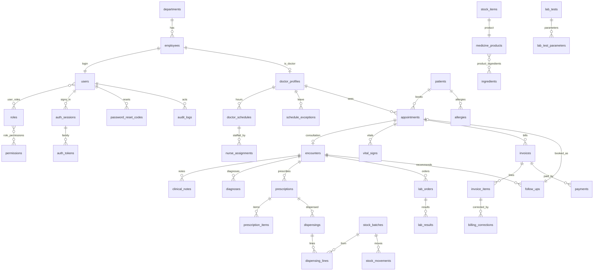
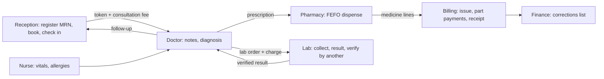

# HospitalOS Mobile: Release 1 report

Status: **Release 1 implemented locally, not complete.** Uncommitted on branch
`release/r1-outpatient-operations` (from `2250fd6`). Every automated check below was run on
2026-11-06. **Android emulator and physical-device validation have not been done** (no Android SDK on
the development Mac, KI-1), so the Release 1 gate (roadmap §3: the journey on an emulator and a
physical phone, owner sign-off) is **not met**. The app is not approved for real patient data.

## 1. Feature summary

| Phase | Delivered (API + database + mobile screens + tests) |
|---|---|
| 1.2 Authentication and accounts | Incoming-link guard first (AD-M-017); sign-in with argon2id, per-IP and per-account-per-IP lockout, opaque tokens (15 min access in memory, rotating refresh in SecureStore, reuse detection revoking the family), 30 min idle / 12 h absolute sessions, sign-out, sign-out everywhere, change password, forced change, forgot/reset by 8-digit code (HMAC, 15 min, 5 attempts, 3/account/h, 10/IP/h, generic answers), app-version gate (426), audited Super Admin bootstrap and operator reset (interactive CLIs), demo accounts (dev/test only), staff administration (HR creates, SA grants/revokes, ADM/SA enable/disable, last SA protected). Screens: Sign in, Forgot password, Change password (forced and voluntary), Staff accounts |
| 1.3 Reference data | Departments, doctors with fees, weekly hours and leave/blocks, service catalogue and prices, locations, medicine catalogue (generic, brand, strength, form) with batches, lab tests with reference ranges; synthetic seed for dev/test; fee/price/hours changes permission-checked and audited |
| 1.4 Patients | Registration with sequence MRN, duplicate warning (same phone + birth date, or similar name + birth date) without merging, MRN/phone/name search (max 20, audited), versioned demographics, allergies, visit history. Screens: Search, Register, Patient |
| 1.5 Scheduling and reception | Availability from hours in hospital time, booking (database EXCLUDE constraint), walk-in, check-in with gap-free daily token and consultation fee on the visit's draft invoice, cancel (fee off a draft or a billing correction), reschedule (atomic), no-show, "did not arrive". Screens: Book, Reception queue with check-in/cancel/no-show, Walk-in |
| 1.6 Doctor and nursing | Care-relationship and nurse-assignment record access; encounters, append-only notes and diagnoses, addenda after completion, entered in error; vitals by the doctor or an assigned nurse; audited chart (audit written before data is returned); nurse session assignments. Screens: Doctor queue, Consultation workspace, Chart, Vitals, Nurse queue, Nurse assignments |
| 1.7 Prescriptions and pharmacy | Prescriptions by the treating doctor with allergy acknowledgement and validity; cancel/close; pharmacy queue; FEFO dispensing (batch locks in id order; expired, recalled and quarantined never used; near-expiry acknowledgement; substitution only if allowed and permitted); stock movements; medicine lines on the draft invoice; idempotent. Screens: Prescription (in consultation), Pharmacy queue, Dispense |
| 1.8 Laboratory | Orders with charges, cancel before collection, worklist, collection with unique barcode, sample rejection, processing, results with factual low/normal/high flags, verification by another person (service + DB CHECK), results back to the chart. Screens: Lab worklist, Lab order |
| 1.9 Billing and payments | One draft per visit, server-side totals, issue with gapless number, issued invoices frozen by triggers, idempotent payments (part payments) never above the collectable balance (total − paid − open corrections), gapless receipts, corrections list. No credit-note/refund/discount/export endpoint. Screens: Invoices, Invoice with issue/pay/receipts |
| 1.10 Follow-ups | Recommend, list with due/overdue computed when read, book as a follow-up appointment, cancel; linked appointment completion/cancel/no-show updates the follow-up. Screens: Follow-ups, Book follow-up |
| 1.11 Dashboards | Per-role figures from live queries only (REC, DOC, NUR, PHA/INV, LAB, FIN, ADM, SA, HR); demo figures remain only for the development demo session, labelled DEMO DATA. Screen: Home |

## 2. Architecture changes in R1

- `apps/api`: modules `auth`, `admin`, `reference`, `patients`, `scheduling`, `clinical`, `pharmacy`,
  `lab`, `billing`, `dashboard`; shared `access` (record-level), `idempotency`, `billing.core`.
  Queries via Drizzle's `sql` template with Zod-parsed rows (AD-M-021). Unauthenticated `/api/v1/*`
  answers 401 (AD-M-022). Opt-in CORS for the development web build (`CORS_ORIGINS`).
- `packages/contracts`: the single catalogue (11 roles, 88 permissions) and every request/response
  schema; re-exports `z` (one zod instance for the app).
- `apps/mobile`: reads the contracts from source (AD-M-018); session manager; TanStack Query hooks;
  role screens; in-memory token store on web only (Android/iOS use the keystore).
- Docker: `hospitalos-mobile-mail` (Mailpit, 127.0.0.1:1026/8026) added to our project.

## 3. Database (ERD summary)

Migrations (forward-only, checksummed, each dry-run in a rolled-back transaction first):
`0000_extensions.sql`, `0001_identity.sql`, `0002_identity_fixes.sql` (fix-forward of a trigger
function in 0001), `0003_reference_data.sql`, `0004_outpatient.sql`. Applied to `hospitalos_test` and
`hospitalos_dev`.

## 4. API route catalogue (86 routes, generated from the route files)

| Method | Path | Permission |
|---|---|---|
| GET | `/api/v1/admin/staff` | any of user:create, user:manage, user_role:assign |
| GET | `/api/v1/admin/staff/:id` | any of user:create, user:manage, user_role:assign |
| POST | `/api/v1/admin/staff` | user:create |
| POST | `/api/v1/admin/users/:id/roles/grant` | user_role:assign |
| POST | `/api/v1/admin/users/:id/roles/revoke` | user_role:assign |
| POST | `/api/v1/admin/users/:id/status` | user:manage |
| GET | `/api/v1/admin/roles` | any of user:create, user:manage, user_role:assign |
| GET | `/api/v1/admin/permissions` | any of user:create, user:manage, user_role:assign |
| GET | `/api/v1/admin/audit/auth` | audit:read |
| POST | `/api/v1/auth/sessions` | public |
| POST | `/api/v1/auth/token` | public |
| POST | `/api/v1/auth/password/forgot` | public |
| POST | `/api/v1/auth/password/reset` | public |
| GET | `/api/v1/app/version-policy` | public |
| GET | `/api/v1/auth/me` | signed in |
| GET | `/api/v1/auth/me/permissions` | signed in |
| DELETE | `/api/v1/auth/sessions/current` | signed in |
| POST | `/api/v1/auth/sessions/logout-all` | signed in |
| POST | `/api/v1/auth/password` | signed in |
| GET | `/api/v1/invoices` | invoice:read |
| GET | `/api/v1/invoices/:id` | invoice:read |
| POST | `/api/v1/invoices/:id/issue` | invoice:issue |
| POST | `/api/v1/invoices/:id/payments` | payment:record |
| GET | `/api/v1/payments/:id/receipt` | invoice:read |
| GET | `/api/v1/billing-corrections` | invoice:read |
| GET | `/api/v1/patients/:id/chart` | patient:read_clinical |
| POST | `/api/v1/encounters` | encounter:write |
| GET | `/api/v1/encounters/:id` | patient:read_clinical |
| POST | `/api/v1/encounters/:id/notes` | encounter:write |
| POST | `/api/v1/encounters/:id/diagnoses` | encounter:write |
| POST | `/api/v1/encounters/:id/complete` | encounter:write |
| POST | `/api/v1/encounters/:id/entered-in-error` | encounter:write |
| POST | `/api/v1/vitals` | vitals:record |
| POST | `/api/v1/encounters/:id/follow-ups` | followup:recommend |
| GET | `/api/v1/follow-ups` | [followup:schedule, followup:recommend] |
| POST | `/api/v1/follow-ups/:id/cancel` | [followup:schedule, followup:recommend] |
| GET | `/api/v1/nurse-assignments` | [nurse_assignment:manage, vitals:record] |
| POST | `/api/v1/nurse-assignments` | nurse_assignment:manage |
| POST | `/api/v1/nurse-assignments/:id/revoke` | nurse_assignment:manage |
| GET | `/api/v1/dashboard` | signed in |
| GET | `/api/health` | public (liveness) |
| GET | `/api/ready` | public (readiness) |
| POST | `/api/v1/encounters/:id/lab-orders` | lab_order:create |
| POST | `/api/v1/lab-orders/:id/cancel` | lab_order:cancel |
| GET | `/api/v1/lab-orders` | any of lab:process, lab_result:enter, lab_result:verify |
| GET | `/api/v1/lab-orders/:id` | any of lab:process, lab_result:enter, lab_result:verify |
| POST | `/api/v1/lab-orders/:id/collect` | lab:process |
| POST | `/api/v1/lab-orders/:id/reject-sample` | lab:process |
| POST | `/api/v1/lab-orders/:id/process` | lab:process |
| POST | `/api/v1/lab-orders/:id/results` | lab_result:enter |
| POST | `/api/v1/lab-orders/:id/verify` | lab_result:verify |
| POST | `/api/v1/lab-orders/:id/reject-results` | lab_result:verify |
| POST | `/api/v1/patients` | patient:create |
| GET | `/api/v1/patients` | patient:read_demographics |
| GET | `/api/v1/patients/:id` | patient:read_demographics |
| PATCH | `/api/v1/patients/:id` | patient:update_demographics |
| GET | `/api/v1/patients/:id/visits` | patient:read_demographics |
| POST | `/api/v1/patients/:id/allergies` | allergy:record |
| POST | `/api/v1/encounters/:id/prescriptions` | prescription:create |
| GET | `/api/v1/prescriptions` | prescription:dispense |
| GET | `/api/v1/prescriptions/:id` | [prescription:dispense, prescription:create] |
| POST | `/api/v1/prescriptions/:id/cancel` | prescription:cancel |
| POST | `/api/v1/prescriptions/:id/close` | prescription:close |
| POST | `/api/v1/prescriptions/:id/dispense` | prescription:dispense |
| GET | `/api/v1/hospital` | signed in |
| GET | `/api/v1/departments` | signed in |
| GET | `/api/v1/doctors` | schedule:read |
| GET | `/api/v1/doctors/:id` | schedule:read |
| GET | `/api/v1/doctors/:id/schedules` | schedule:read |
| POST | `/api/v1/doctors/:id/schedules` | schedule:manage |
| POST | `/api/v1/schedules/:id/deactivate` | schedule:manage |
| PUT | `/api/v1/doctors/:id/fee` | fee:manage |
| GET | `/api/v1/services` | [ invoice:read, price:manage, lab_order:create, schedule:read, lab:process, ] |
| PUT | `/api/v1/services/:id/price` | price:manage |
| GET | `/api/v1/medicines` | medicine:search |
| GET | `/api/v1/lab-tests` | [ lab_order:create, lab:process, lab_result:enter, lab_result:verify, ] |
| GET | `/api/v1/doctors/:id/availability` | schedule:read |
| GET | `/api/v1/appointments` | [appointment:read_all, encounter:write] |
| GET | `/api/v1/appointments/:id` | [appointment:read_all, encounter:write] |
| POST | `/api/v1/appointments` | appointment:book |
| POST | `/api/v1/appointments/walk-in` | appointment:check_in |
| POST | `/api/v1/appointments/:id/check-in` | appointment:check_in |
| POST | `/api/v1/appointments/:id/cancel` | appointment:cancel |
| POST | `/api/v1/appointments/:id/reschedule` | appointment:reschedule |
| POST | `/api/v1/appointments/:id/no-show` | appointment:mark_no_show |
| GET | `/api/v1/queue` | queue:read |

Contracts for every body are the Zod schemas in `packages/contracts/src` (auth, reference, patients,
scheduling, clinical, pharmacy, lab, billing, dashboard). **OpenAPI is not generated yet** (KI-17).

## 5. Role and permission verification

- Seed equals the contracts exactly: 11 roles, 88 permissions, 241 grants (database test); readiness
  fails if the catalogue drifts; the app has no second copy (KI-6 resolved).
- Every route checks a permission, and services check record-level relationships (care window,
  nurse assignment, own encounter/prescription/order). The journey test asserts a refusal at each
  stage (e.g. MKT 403 on patients and charts, REC/PHA 403 on prescribing, unassigned nurse 404,
  other doctor 404, same-user lab verification 403, doctor 403 on invoices).

## 6. Cross-department workflow

## 7. Mobile screen inventory

Sign in · Forgot password · Change password (forced/voluntary) · Home (live figures per role; demo
for the dev demo session only) · Work Queue (reception, doctor, nurse, pharmacy, lab, billing
sections by permission) · Search (patients) · Inbox (Release 7 placeholder) · Profile · Settings ·
Register patient · Patient · Chart · Book / Book follow-up · Follow-ups · Consultation · Vitals ·
Dispense · Lab order · Invoice · Staff accounts · Nurse assignments · Module pages for later releases.

## 8. Test report (run 2026-11-06)

| Suite | Result |
|---|---|
| Contracts (Vitest) | 9/9 |
| API unit and HTTP (Vitest + Supertest) | 49/49 |
| Database integration (`hospitalos_test`) | 71/71 in 8 files: identity, migrations, readiness, server process, auth, reference data, the 15-step journey, safety (concurrent booking ×10, concurrent MRNs, duplicates, check-in day rules, reschedule, no-show, walk-in tokens and idempotency, concurrent dispensing, expired/recalled/near-expiry/FEFO, expired prescription, draft recalculation vs correction, DB refuses rewriting an issued invoice, concurrent payment retries, no R3 endpoints, lab step order and barcodes) |
| Mobile (Jest + RNTL) | 210/210 in 15 suites (link guard 84, session manager, auth flow, navigation, dashboards, access) |
| Browser journey (web build + real API, Playwright) | Passed: REC register (duplicate warning confirmed) → book → check-in; DOC note, diagnosis, prescription, CBC, complete; PHA FEFO dispense; LAB collect/results; SA verifies; FIN issue + UPI payment ₹868.00 + receipt; ADM nurse assignment; SA staff list |
| Typecheck, ESLint, Prettier (root and mobile), secret scan (299 files), iso:check, `git diff --check` | Pass |
| Android export | 1,523 modules bundled |
| Expo Doctor | 20/21 (patch updates deferred to 2026-11-19, KI-9) |
| Android emulator / physical device | **Not run** (KI-1) |

## 9. Security review (R1)

- Fixed during R1: error logs could include query parameters (now name, PostgreSQL code and
  constraint only); `SELECT … FOR UPDATE` needed privileges `hos_app` must not have (advisory locks).
- Controls verified by tests: hash-only token storage, refresh reuse revocation, lockouts and rate
  limits at their boundaries, generic reset answers, no secrets or codes in logs, append-only audit
  (even for the owner), record-level access, idempotency, database-level invoice immutability,
  double-booking and overselling prevented under concurrency, incoming-link guard.
- Open: KI-12 production link-parsing advisory mitigated (not fixed) until Expo SDK 58; development
  advisories deferred to 2026-11-19; no penetration test; no OpenAPI; no device-level testing of
  SecureStore behaviour.

## 10. Android evidence

None. No emulator or device run has been possible on this machine (KI-1). Nothing in this report
claims Android verification.

## 11. Performance observations

Local, not representative of a mid-range phone: the database suite (71 tests with concurrency)
runs in about 5 s; dashboard queries are single aggregates per figure; patient search is indexed
(phone, trigram name, MRN) and capped at 20. No device profiling done.

## 12. Known issues

See `docs/KNOWN-ISSUES.md` (KI-1 Android, KI-9/12 dependencies, KI-15 test warnings, KI-16 no SA in
dev, KI-17 OpenAPI, KI-18 web session memory-only, KI-19 doctor call requests R7, KI-20 schedule and
catalogue management screens).

## 13. Release checklist

| Item | State |
|---|---|
| All R1 API endpoints with permission + record checks | Done |
| All R1 migrations applied to test and dev | Done |
| Integrated journey automated (API) | Done |
| Integrated journey through the app UI | Done on the web build; **not on Android** |
| Mobile screens for every R1 role | Done (management screens for schedules/fees/catalogue are API-only, KI-20) |
| Security tests | Done for the controls above |
| Android emulator at 360×640 and 411×891 | **Not done** |
| Physical Android phone | **Not done** |
| Accessibility pass (TalkBack, 200% text, reduced motion on device) | **Not done** |
| Owner sign-off | Pending |

## 14. Deployment readiness

Not ready for production or real patient data: no device validation, no production hosting, TLS,
backups drill, monitoring or production email (R9), open KI-12, and the human clinical, privacy,
security and legal reviews required before real data have not happened.

## 15. Recommended Release 2 plan

1. Android validation of R1 (emulator then a physical phone) and fixes; Expo patch on 2026-11-19.
2. Management screens for schedules, leave, fees, prices and catalogue (APIs exist).
3. Account governance: My Devices, administrator password resets, work-email changes, audit viewer.
4. End-of-day job design and approved build (no-shows, missed follow-ups, closed prescriptions,
   reconciliation), emergency access and review, document-export design.
5. OpenAPI generation from the contracts; Expo SDK 58 upgrade plan (fully fixes KI-12).
